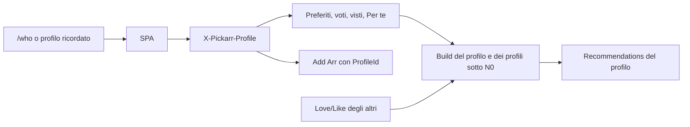

# ANALYSIS — multi-profilo

> Generato da: agente di pianificazione
> Data assessment: 2026-11-09
> Branch: `main` @ `073a4bbeb32631ab2dc5bc903514434e42ba85af`
> Worktree: sporco, modifiche preesistenti fuori scope. Elenco in STATUS.md §0.

## 1. Contesto e perimetro

### 1.1 Obiettivo

Aggiungere fino a 10 profili sulla stessa installazione, senza autenticazione. Il primo profilo è l'amministratore, creato da solo e destinatario di tutti i dati personali già presenti. L'amministratore gestisce integrazioni, provider, job e le impostazioni globali. Gli altri profili non vedono le impostazioni. Preferiti, voti, visti e raccomandazioni sono del profilo. I consigli di un profilo nuovo usano, solo finché ha pochi segnali, un prior costruito con i mi piace degli altri profili.

Richiesta originale (2026-11-09), conservata in sintesi fedele:

- un amministratore (il primo utente) gestisce settings, integrazioni, provider, job;
- gli altri non accedono ai settings;
- ogni profilo ha la propria lista e le proprie raccomandazioni;
- valutare se il modello di raccomandazione resta valido o serve un modello più complesso con segnali cross-utente;
- niente autenticazione: i profili sono separati, massimo 10;
- all'apertura, schermata di scelta tipo «chi sta guardando»;
- i dati attuali migrano sull'amministratore, unico profilo creato in automatico;
- solo l'amministratore crea ed elimina profili; ognuno modifica nome e icona propri; l'amministratore modifica tutti i profili.

Modifiche approvate il 2026-11-09, prima dei documenti:

| Tema | Scelta |
| --- | --- |
| Dominio KB | `multi-profilo` |
| Memoria del profilo | L'ultimo profilo resta nel browser e al ritorno si entra diretti, con un comando per cambiare |
| Settings | Divieto solo di interfaccia. Le API di settings restano aperte |
| Dati personali | Preferiti, voti e storico voti, visti, punteggi, profilo e log delle raccomandazioni |
| Sonarr/Radarr | Tutti possono aggiungere e rimuovere. La libreria è di casa |
| Preferenze reco | Modello e pesi restano globali, solo admin. Segnali impliciti ed esclusione libreria diventano preferenze del profilo |
| Cross-utente | Solo aiuto a un profilo con pochi voti. Poi conta solo quel profilo |
| Un solo profilo | Si entra diretti. Il selettore compare dal secondo profilo |
| Icona | Colore + iniziale del nome. Nessun upload |
| Admin iniziale | Nome «Admin», icona predefinita, modificabili dopo. Non eliminabile, ruolo non cedibile |

| Requisito | Criterio verificabile | Task | Fonte |
| --- | --- | --- | --- |
| R-01 | Esiste sempre un profilo `IsAdmin`. Una installazione vuota o già popolata ne ha uno dopo migrazione/seed. Non se ne può creare un secondo. Il ruolo non si trasferisce e non si cancella. | T01, T03 | richiesta + admin-rinominabile |
| R-02 | I dati personali già presenti (preferiti, voti, `RatingEvents`, visti, raccomandazioni, `RecoState` di gusto, `RecoEventLog`) referenziano l'admin. Cataloghi, titoli, availability, embedding, settings e righe di libreria Arr restano globali. | T01 | richiesta migrazione |
| R-03 | Massimo 10 profili, admin compreso. Nome obbligatorio, univoco senza distinzione di maiuscole, 1–40 caratteri dopo trim. | T03 | richiesta + piano |
| R-04 | Creazione, eliminazione e modifica di un altro profilo richiedono che l'id nel header sia l'admin. La modifica del proprio nome, colore e preferenze no. L'admin non è eliminabile. | T03 | richiesta; D-008 |
| R-05 | Preferiti, voti, storico voti e visti sono per coppia profilo+titolo. Due profili possono divergere sullo stesso titolo. | T02, T04, T05 | dati personali |
| R-06 | Le API personali ricevono il profilo in `X-Pickarr-Profile`. Senza header, le mutazioni di preferiti/voti/visti e le letture di liste personali rispondono 400. Il catalogo senza header resta leggibile, con i flag personali vuoti. | T04, T05 | D-007 |
| R-07 | `isFavorite`, voto e visto nei DTO di catalogo e scheda sono quelli del profilo dichiarato. | T05 | R-05 |
| R-08 | Build, stato, punteggi e log reco sono per profilo. Il modello ONNX, la copertura embedding e i pesi restano globali. I segnali Arr di una nuova azione restano sul profilo che l'ha eseguita. Lo storico Arr preesistente va all'admin. | T06 | preferenze reco + libreria condivisa |
| R-09 | `reco.useImplicit` e `reco.excludeInLibrary` non guidano più il calcolo. Valgono i campi del profilo. Le chiavi globali possono restare memorizzate. | T09 | preferenze reco |
| R-10 | Con `N_eff ≥ N0` il contributo degli altri profili è 0. Con `N_eff < N0` entra solo la media dei Love/Like altrui, nel tetto D-006. Dislike, preferiti e visti altrui non entrano. Un solo profilo riproduce il prior attuale. | T07 | opzione freddo |
| R-11 | Con un profilo si entra in catalogo senza selettore. Con due o più, un id ricordato e ancora valido entra diretto. Id assente o eliminato apre il selettore. Il comando in header apre sempre il selettore. | T08 | memoria + gate |
| R-12 | Un profilo non admin non vede il link Settings e una URL `/settings` lo riporta al catalogo. Le API `/api/v1/settings` e i job restano chiamabili. | T08 | enforcement ui |
| R-13 | Nome e colore si modificano dal profilo. L'admin crea, elimina gli altri e modifica tutti. L'icona è un colore di una palette fissa più la prima lettera del nome. | T09 | icona + ruoli |
| R-14 | `docs/documento-funzionale.md`, `docs/specifica-tecnica.md`, `docs/raccomandazioni.md` e i confini in `AGENTS.md` descrivono profili, migrazione e prior di casa. | T10 | AGENTS.md |

### 1.2 Fonti analizzate

- `src/Pickarr.Api/Program.cs`
- `src/Pickarr.Api/Endpoints/SettingsEndpoints.cs`
- `src/Pickarr.Core/Domain/Entities/Title.cs`, `Favorite.cs`, `Watched.cs`, `Rating.cs`, `RatingEvent.cs`, `Recommendation.cs`, `RecoState.cs`, `RecoEventLog.cs`, `ArrAuditLog.cs`
- `src/Pickarr.Core/Recommendations/RecoSignals.cs`, `RecoLearning.cs`
- `src/Pickarr.Infrastructure/Catalog/RecoBuildService.cs` (fino al calcolo del prior)
- `src/Pickarr.Infrastructure/Persistence/DatabaseInitializer.cs`, configurazioni EF di Favorite, Watched, Rating, Recommendation, RecoState, RecoEventLog
- `src/Pickarr.Infrastructure/Persistence/PickarrDbContext.cs`
- `src/Pickarr.WebApp/src/app/router.tsx`, `components/layout/Header.tsx`, `lib/sourcePreference.ts`
- `docs/raccomandazioni.md` §§1–3, §9, §12 (formule `N_eff`, stadi, fusione)
- Test: `EnsureCreated` nei test Infrastructure; `MigrateAsync` solo in `DatabaseInitializer`

### 1.3 Stato as-is

Non esiste un utente. Non c'è `UseAuthorization`. Chi raggiunge l'host usa le stesse API.

`Favorite`, `Watched` e `Rating` hanno chiave `TitleId` e navigazione 1:1 su `Title`. `RatingEvent`, `Recommendation`, `RecoState` (riga `Id = 1`) e `RecoEventLog` sono anch'essi unici per l'installazione. `RecoBuildService.BuildAsync` calcola un solo profilo di gusto. I pesi, `reco.useImplicit` e `reco.excludeInLibrary` sono `AppSetting`. Gli embedding dei titoli e lo stato del modello stanno sulla stessa riga `RecoState`.

La libreria Sonarr/Radarr (`ArrLibraryItem`, `ArrAuditLog`) non ha un attore. L'audit non ricorda chi ha aggiunto.

L'UI parte da `/` e va a `/catalog`. La sorgente catalogo è `localStorage` `pickarr.sourceId`, per browser. Settings è in header per chiunque.

Il modello di gusto è content-based: prior TMDB, profilo sparso, kNN sugli embedding, classificatore opzionale. `N_eff = Σ|s_i|`. `w = min(1, N_eff/N0)` con `N0 = 30`, e a regime il prior tiene un residuo `ε = 0,1`. Non c'è collaborative filtering. Con al massimo 10 profili un modello utente-utente non ha abbastanza massa: il content-based per profilo resta il motore, e il cross-utente è solo il prior di casa di R-10.

## 2. Componenti principali

| Componente | Ruolo | File | Accoppiamento |
| --- | --- | --- | --- |
| `Title` | Titolare delle navigazioni 1:1 verso preferito, visto, voto | `src/Pickarr.Core/Domain/Entities/Title.cs` | alto |
| `Favorite` / `Watched` / `Rating` | Un record per titolo | entità e `*Configuration.cs` omonime | alto |
| `FavoriteService`, `RatingService`, `WatchedService` | Scrittura dei dati personali | `src/Pickarr.Infrastructure/Catalog/` | alto |
| `RecoSignals` / `RecoLearning` | Pesi, `N_eff`, fusione prior+personale | `src/Pickarr.Core/Recommendations/` | medio |
| `RecoBuildService` | Un build globale, legge settings e `RecoState` id 1 | `src/Pickarr.Infrastructure/Catalog/RecoBuildService.cs` | alto |
| `RecoQueryService`, `RecoEvalService`, `RecoModelService`, `RecoEmbeddingService` | Lettura consigli, eval, modello | `src/Pickarr.Infrastructure/Catalog/` e `Metadata/Reco/` | alto |
| `DatabaseInitializer` | `MigrateAsync` poi seed provider/settings | `src/Pickarr.Infrastructure/Persistence/DatabaseInitializer.cs` | medio |
| `SettingsEndpoints` | GET/PUT settings e cataloghi, senza ruolo | `src/Pickarr.Api/Endpoints/SettingsEndpoints.cs` | basso |
| Router e header | Nessun gate, link Settings sempre visibile | `router.tsx`, `Header.tsx` | medio |
| `sourcePreference` | Sorgente catalogo per browser | `src/Pickarr.WebApp/src/lib/sourcePreference.ts` | basso |

## 3. Flussi individuati

### FLUSSO-01 — Apertura e profilo attivo

- **Trigger**: caricamento SPA, rotta `/`.
- **File sorgente**: `src/Pickarr.WebApp/src/app/router.tsx`
- **Sequenza**: redirect a `/catalog`. Nessuna scelta profilo.
- **Dipendenze**: nessuna.
- **Rischi**: la rotta condivisa con il worktree già modificato (`router.tsx`).
- **Test esistenti**: test di routing catalogo/favoriti.

### FLUSSO-02 — Preferiti, voti, visti

- **Trigger**: PUT/DELETE su `/api/v1/favorites/{titleId}` e gli endpoint voti/visti.
- **File sorgente**: service in `src/Pickarr.Infrastructure/Catalog/`, entità Core.
- **Sequenza**: upsert per `TitleId`. Il catalogo legge `Title.Favorite` / `Rating` / `Watched` come singolo.
- **Dipendenze**: SQLite.
- **Rischi**: la chiave e la navigazione 1:1 vanno rotte insieme, altrimenti EF non mappa due profili.
- **Test esistenti**: `FavoriteServiceTests`, `RatingServiceTests`, query titolo.

### FLUSSO-03 — Build raccomandazioni

- **Trigger**: job dopo un voto, azione admin di ricostruzione.
- **File sorgente**: `RecoBuildService.BuildAsync`
- **Sequenza**: pool dalle availability abilitate; segnali globali (voto, preferito, visto, add Arr riuscito, downloaded); `RecoSignals.Compute`; profilo sparso; kNN se il modello è pronto; prior; `RecoLearning.FuseScore`; scrive `Recommendations` e la riga `RecoState` id 1.
- **Dipendenze**: settings `reco.*`, embedding globali, audit Arr globale.
- **Rischi**: lo stato modello e lo stato gusto condividono la riga. Un `ProfileId` sulla stessa riga deve lasciare un solo scrittore per il modello.
- **Test esistenti**: `RecoBuildServiceTests`, test Core su `RecoSignals` / `RecoLearning`.

### FLUSSO-04 — Arr add/delete

- **Trigger**: azioni di libreria dagli endpoint Arr.
- **File sorgente**: `ArrAuditLog`, servizi Arr.
- **Sequenza**: una riga di audit senza attore. Il build tratta ogni Add+Success come segnale di gusto dell'unico utente. Delete non cancella il segnale.
- **Dipendenze**: Sonarr/Radarr.
- **Rischi**: se il build per profilo continuasse a leggere tutti gli Add, ogni profilo erediterebbe la libreria di casa.
- **Test esistenti**: `ArrAddDeleteTests`.

### FLUSSO-05 — Settings

- **Trigger**: link header `/settings`, GET/PUT `/api/v1/settings`.
- **File sorgente**: `Header.tsx`, `SettingsEndpoints`, pagine in `features/settings/`.
- **Sequenza**: nessuna distinzione di ruolo. `useImplicit` e `excludeInLibrary` sono sulla pagina settings e su `RecommendationsSettingsPage`.
- **Dipendenze**: `AppSetting`.
- **Rischi**: togliere i due toggle prima di leggerli dal profilo lascia le preferenze non modificabili. L'ordine è T06 (ancora settings) poi T09 (spostamento e nuova fonte).
- **Test esistenti**: `SettingsPage.test.tsx`, `RecommendationsSettingsPage.test.tsx`, `SettingsAndHealthTests`.

## 4. Dipendenze e vincoli tecnici

| Dipendenza | Tipo | Vincolo | Impatto |
| --- | --- | --- | --- |
| SQLite + EF migrations | infra | V-01, V-02 | Backfill nell'SQL di migrazione. I test usano `EnsureCreated` e non eseguono quel SQL |
| Assenza di autenticazione | prodotto | V-03, D-004, D-008 | Il header sceglie la partizione. Non prova l'identità |
| Modello reco content-based | dominio | D-006, R-10 | Non si introduce un classificatore collaborativo |
| Hangfire, coda build | infra | nessuno nuovo | Il build deve indicare il profilo, non restare singleton |
| Worktree sporco | processo | V-06 | `router.tsx`, `Header.tsx`, docs e settings layout hanno diff preesistenti |
| `Directory.Packages.props`, nullable, warnings as errors | build | AGENTS.md | Nessun suppress nuovo |

## 5. Problematiche e tech debt rilevati

| ID | Gravità | Descrizione | Impatto se non risolto |
| --- | --- | --- | --- |
| A-001 | Alta | Preferito, visto e voto sono 1:1 con `Title` (`HasKey(TitleId)`, `WithOne`). | Il secondo profilo non può avere una propria riga |
| A-002 | Alta | `RecoState.SingletonId` mescola modello ONNX e profilo di gusto. `Recommendations` è unica per versione+titolo. | Un build di un profilo sovrascrive l'altro, oppure il modello viene clonato male |
| A-003 | Media | `ArrAuditLog` non ha attore. Il segnale Add è globale. | I profili condividono lo stesso gusto implicito di libreria |
| A-004 | Media | I test Infrastructure creano lo schema con `EnsureCreated`, non con le migrazioni. | Un backfill solo SQL non è coperto dai test e non protegge un DB di test |
| A-005 | Bassa | `pickarr.sourceId` è per browser. | Cambiando profilo si resta sulla sorgente dell'altro. D-009 lo spezza per profilo |

Questi punti nascono dall'assessment. I finding di esecuzione vanno in STATUS.md §3.

## 6. Architettura target (to-be)

### 6.1 Principi

- Il profilo è una partizione dei dati di gusto, non un account.
- L'admin è un flag di un profilo, non un utente di sistema separato.
- Catalogo, metadata, embedding, quote, job e libreria Arr restano dell'installazione.
- Il calcolo reco attuale resta. Cambia la chiave (il profilo) e, sotto `N0`, il termine di prior.
- Il ruolo si applica nell'UI. Sulle API di gestione profili il controllo legge il profilo dichiarato ed è aggirabile. Sulle API di settings non c'è controllo.

### 6.2 Pattern

Entità `Profile` (`Id`, `Name`, `Color`, `IsAdmin`, `UseImplicit`, `ExcludeInLibrary`, `CreatedAt`).

Chiave composta `(ProfileId, TitleId)` su `Favorite`, `Watched`, `Rating`. `RatingEvent`, `Recommendation`, `RecoEventLog` e `ArrAuditLog` guadagnano `ProfileId`. `RecoState` ha una riga per profilo: i campi di gusto sono della riga; `ModelStatus`, `ModelId`, `EmbeddingCoverage`, `Level3Active` e l'eval del modello si leggono e si scrivono solo sulla riga dell'admin.

Header `X-Pickarr-Profile: {id}` sulle richieste dell'app dopo la scelta. Le mutazioni personali senza header sono 400. Creare, eliminare o modificare un altro profilo senza un admin dichiarato è 403. Cancellare l'admin è 409. Il decimo profilo in creazione è 409.

UI: rotta `/who`. Contesto React + `localStorage` `pickarr.profileId`. Palette fissa di colori; l'iniziale non è persistita. Sorgente catalogo in `pickarr.sourceId.{profileId}`, con lettura una tantum della chiave legacy quando il profilo admin non ha ancora la propria.

Prior di casa, solo nel punteggio (D-006):

```
raw = min(1, N_eff / N0)
personalWeight = min(raw, 1 - ε)          # RecoLearning.PersonalWeight, invariato
h = 0 se nessun altro profilo ha Love o Like, altrimenti 0,5 * (1 - raw)
priorSlot = (1 - h) * prior + h * household
score = (1 - personalWeight) * priorSlot + personalWeight * personal
```

`household` è il punteggio sparso (livello 1) della media, per titolo, dei pesi Love/Like degli altri profili. Chi non ha votato il titolo non entra nella media. A `raw = 1` si ritrova la fusione attuale. A `raw = 0` senza altri voti positivi si ritrova il prior.

Un voto ricostruisce il profilo che ha votato e i profili ancora sotto `N0`. I profili già a `N_eff ≥ N0` non si ricostruiscono per un voto altrui.

### 6.3 Alternative scartate

| Alternativa | Pro | Contro | Motivo |
| --- | --- | --- | --- |
| Collaborative filtering sulla matrice profili×titoli | Segnali cross-utente espliciti | Con ≤10 profili la matrice è vuota; mescola i dislike | Direzione approvata: solo aiuto a freddo, content-based |
| Prior di casa anche a regime, peso piccolo permanente | Stabilità | Contraddice «poi conta solo quel profilo» | Scartata con l'opzione `sempre` |
| Controllare anche le API settings col profilo dichiarato | Allinea server e UI | L'utente ha scelto il divieto solo visivo | D-004 |
| API di creazione profili senza alcun controllo | Coerente col divieto settings | Annulla «solo l'admin crea ed elimina» anche per chi usa l'app in modo normale | D-008, da confermare col piano |
| Upload immagine profilo | Icone riconoscibili | Scrittura file in `/config`, nessuna richiesta | Opzione iniziale scartata |
| Mostrare il selettore anche con un solo profilo | Abitudine Netflix | L'utente ha scelto il salto | D-005 |

### 6.4 Flusso target



## 7. Scoperte post-assessment

| Data | Sezione impattata | Scoperta | Impatto sul piano |
| --- | --- | --- | --- |
| 2026-11-09 | §8 K-006 | `20261109164224_AddProfiles` assegna all'admin le righe già presenti di preferiti, voti, eventi, visti, raccomandazioni, `RecoState`, `RecoEventLog` e `ArrAuditLog`. `ArrLibraryItem` non riceve `ProfileId`. | K-006 confermata da `ProfileAdminMigrationTests`. D-011 invariata. La chiave personale resta `TitleId` fino a T02. |
| 2026-11-09 | §8 K-001 | `20261109170529_ScopeFavoritesRatingsWatched` rende `ProfileId` obbligatorio e sposta la PK di Favorite, Watched e Rating su `(ProfileId, TitleId)`. In testa a `Up` le righe con `ProfileId` null vanno all'admin, poi EF altera la colonna. `ProfileAdminMigrationTests` passa ancora dallo schema `AddWatched`. | K-001 superata da K-009. I flag di catalogo restano `Any()` fino a T05. Gli endpoint personali risolvono l'admin fino a T04. |
| 2026-11-09 | §8 K-010 | Le liste personali e `GET /recommendations` richiedono il header. Il build continua a inserire raccomandazioni senza `ProfileId`; la lettura dell'admin include quelle righe. | K-010. T06 deve scrivere il `ProfileId`. T05 non è coperto da questo filtro. |
| 2026-11-10 | §8 K-011 | Catalogo e scheda usano il profilo dell'header. Senza header i flag personali sono vuoti. I simili restano `Any()`. | K-011. T06 partiziona `RecoQueryService`, incluso `QuerySimilarAsync`. |
| 2026-11-10 | §8 K-012 | Build, stato, punteggi, log reco e segnali Arr sono per profilo. Il modello resta sulla riga admin. | K-012. T07 aggiunge il prior di casa. T09 sposta `useImplicit` e `excludeInLibrary` sul profilo. |
| 2026-11-10 | §8 K-013 | Sotto `N0` il punteggio include il prior di casa. Un voto ricostruisce anche i profili ancora sotto `N0`. | K-013. T09 legge i due toggle dal profilo. |
| 2026-11-10 | §8 K-014 | Il selettore è `/who`. I due toggle di gusto si leggono dal profilo, non dalle chiavi globali. | K-014. T10 allinea i documenti. |

## 8. Fatti e ipotesi riusabili

| ID | Tipo | Informazione | Fonte e versione | Rivalidare quando |
| --- | --- | --- | --- | --- |
| K-001 | FACT | `Favorite`, `Watched`, `Rating` hanno PK `TitleId` e `Title` le espone come riferimento singolo | entità e configuration, `main` `073a4bbe` | cambia lo schema o `Title` |
| K-002 | FACT | `RecoLearning.PersonalWeight` = `min(min(1, N_eff/N0), 1-ε)` con `N0=30`, `ε=0,1`. `FuseScore` = `(1-w)*prior + w*personal`. Stadi: cold `<5`, warming `<N0`, personalized `≥N0` | `RecoLearning.cs`, `docs/raccomandazioni.md` BR-REC-04/05, stesso SHA | cambia `RecoLearning` o `N0` |
| K-003 | FACT | L'app applica le migrazioni in `DatabaseInitializer.InitializeAsync`. I test Infrastructure citati usano `EnsureCreatedAsync` | `DatabaseInitializer.cs`, grep test 2026-11-09 | un test inizia a chiamare `MigrateAsync` |
| K-004 | FACT | `Program.cs` mappa le API senza middleware di autenticazione | `Program.cs`, stesso SHA | si aggiunge auth |
| K-005 | FACT | Il build legge `reco.useImplicit` e i pesi dagli `AppSetting`, e l'audit Arr senza filtro di attore | `RecoBuildService` circa righe 116–133, `RecoSignals.Compute` | T06 / T09 |
| K-006 | HYPOTHESIS | Lo storico `ArrAuditLog` va attribuito all'admin, come gli altri dati già presenti. Le righe di libreria no: restano globali | richiesta migrazione, letta in senso largo | T01: confermare che le righe audit esistenti ricevono il `ProfileId` admin e che `ArrLibraryItem` non guadagna `ProfileId` |
| K-007 | DECISION | Scelte di prodotto e formula: STATUS.md §4 | approvazioni 2026-11-09 | una nuova approvazione contraddice una D- |
| K-008 | FACT | La migrazione `20261109164224_AddProfiles` crea un solo admin «Admin» / colore `blue`, copia `reco.useImplicit` e `reco.excludeInLibrary` se valgono `false`, e backfilla `ProfileId`. `EnsureAdminProfileAsync` non crea un secondo admin e non sovrascrive le preferenze. Un secondo `IsAdmin` viola l'indice unico `"IsAdmin" = 1`. Supera K-006. | `AddProfiles.cs`, `ProfileAdminMigrationTests`, suite Infrastructure 137 pass sullo SHA `073a4bbe` con worktree T01 | se la migrazione o l'indice admin cambiano |
| K-009 | FACT | Favorite, Watched e Rating hanno PK `(ProfileId, TitleId)` e `Title` le espone come collezioni. `RatingEvent.ProfileId` è obbligatorio, fuori dalla PK, con delete a cascata dal profilo. La migrazione `20261109170529_ScopeFavoritesRatingsWatched` riassegna i null all'admin prima dell'alter. Supera K-001. I service filtrano per profilo; `TitleQueryService` e `RecoQueryService` usano ancora `Any()`; `RecoBuildService` legge ancora tutte le righe. | entità, `ScopeFavoritesRatingsWatched.cs`, `ProfileAdminMigrationTests`, Infrastructure 140 pass e Integration 45 pass sullo SHA `073a4bbe` con worktree T02 | T04 cambia la risoluzione dell'admin sugli endpoint; T05 filtra i flag; T06 partiziona il build |
| K-010 | FACT | `GET/PUT/DELETE` di preferiti, voti, visti, export/import/onboarding e `GET /recommendations` senza `X-Pickarr-Profile` rispondono 400. Con header leggono e scrivono solo quel profilo. `GET /profiles` e le API settings restano senza header. Il client personale manda l'id in `localStorage` `pickarr.profileId` e, se manca, l'id admin da `GET /profiles`. Le righe `Recommendation` con `ProfileId` null restano nel risultato dell'admin finché il build non le partiziona. I flag di catalogo e scheda restano `Any()`. | `ProfilesEndpoints`, `ProfileRequest`, `RecoQueryService.QueryAsync`, Integration 51 pass e `client.test.ts` 8 pass sullo SHA `073a4bbe` con worktree T04 | T05 filtra i flag; T06 scrive `ProfileId` sul build |
| K-011 | FACT | `GET /api/v1/catalog/sources/{id}/titles` e `GET /api/v1/titles/{id}` con `X-Pickarr-Profile` espongono `isFavorite`, voto e visto solo di quel profilo. Senza header rispondono 200 e quei flag sono falsi o null. Un header presente che non corrisponde a un profilo è 400 `PROFILE_UNKNOWN`. Il catalogo ignora `favorite=true`. Il client manda il header su `fetchTitles` e `fetchTitle`, con la stessa risoluzione di K-010. `QuerySimilarAsync` mappa ancora i flag con `Any()`. | `TitleQueryService.PersonalFlags`, `CatalogEndpoints`, `TitlesEndpoints`, `catalog.ts`; TitleQueryServiceTests 10 pass, Integration 52 pass e `client.test.ts` 9 pass sullo SHA `073a4bbe` con worktree T05 | T06 partiziona i simili e il build |
| K-012 | FACT | `RecoBuildService.BuildAsync(profileId)` scrive `Recommendations` e la riga `RecoState` di quel profilo. `BuildAsync()` senza id ricostruisce tutti i profili. `ModelStatus`, `ModelId`, `EmbeddingCoverage`, `Level3Active` e l'eval si leggono e si scrivono solo sulla riga admin. Un voto o un visto chiama `ScheduleDebouncedRebuild(profileId)` e non cancella il job di un altro profilo. L'Add Arr salva `ProfileId` se l'header è un profilo noto; altrimenti il segnale non entra in nessun profilo. Downloaded conta solo se quel profilo ha un Add riuscito. Delete non toglie l'Add. `useImplicit` e `excludeInLibrary` restano `AppSetting`. La migrazione `20261110083115_ScopeRecommendationsByProfile` rende obbligatorio `ProfileId` su raccomandazioni, stato e log e assegna i null all'admin. I simili escludono voti e visti del profilo e ne mostrano i flag. | `RecoBuildService`, `RecoProfileStates`, `RecoRebuildScheduler`, `ArrAddService`, `RecoQueryService`; Infrastructure 144 pass e Integration 52 pass sullo SHA `073a4bbe` con worktree T06 | T07 aggiunge il prior di casa sotto `N0`; T09 legge i due toggle dal profilo |
| K-013 | FACT | `RecoHousehold.SlotWeight` vale 0 senza Love/Like altrui nel vettore sparso, e `0,5 * (1 - min(1, N_eff/N0))` altrimenti. A `N_eff ≥ N0` è 0. Il termine è la media per titolo dei pesi Love/Like degli altri; Dislike, NotInterested, preferiti e i voti del profilo non entrano. Chi non ha votato il titolo non entra nella media. Il build normalizza il coseno sparso di quel vettore e non ci applica il kNN. Un voto (`Set`, `Clear`, import, onboarding) programma il profilo che ha votato e ogni altro profilo con `EffectiveN < N0`, compresi quelli senza riga `RecoState`. Un profilo già a `N_eff ≥ N0` non viene riprogrammato. Un visto continua a programmare solo il proprio profilo. | `RecoHousehold`, `RecoBuildService.LoadHouseholdNormAsync`, `RatingService.ScheduleTasteRebuildAsync`; `RecoHouseholdTests` 4 pass e Infrastructure 147 pass sullo SHA `073a4bbe` con worktree T07 | T09 legge `useImplicit` e `excludeInLibrary` dal profilo |
| K-014 | FACT | Con un solo profilo l'ingresso va al catalogo e `pickarr.profileId` diventa il suo id. Con più profili un id ancora presente entra diretto; un id assente o sconosciuto apre `/who`. Il controllo in header apre `/who` anche con un profilo ricordato. Un profilo non admin non ha il link Settings e `/settings` torna al catalogo. La sorgente è `pickarr.sourceId.{profileId}`; l'admin senza chiave propria copia una volta `pickarr.sourceId`. Su `/who` l'admin crea fino a 10, elimina gli altri e modifica tutti; non elimina sé e non cede il ruolo. Un altro profilo modifica solo nome, colore e i due toggle propri. Il build legge `Profile.UseImplicit`. Per te e i simili leggono `Profile.ExcludeInLibrary`. Le chiavi `reco.useImplicit` e `reco.excludeInLibrary` non cambiano il calcolo. | `profileContext.tsx`, `WhoPage.tsx`, `RecoBuildService`, `RecoQueryService.ExcludesLibraryAsync`; Vitest router/who/settings e `ProfileRecoPreferenceTests` sullo SHA `073a4bbe` con worktree T09 | T10 descrive lo stesso comportamento nei documenti |
