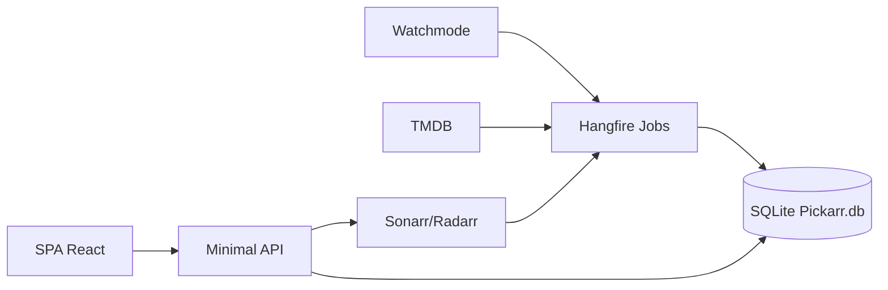

# ANALYSIS — pickarr-mvp

> Generato da: agente incremental-dev-planning
> Data assessment: 2026-11-04
> Branch: `main` (greenfield; solo `docs/`)

---

## 1. Contesto e perimetro

### 1.1 Obiettivo

Implementare da zero **Pickarr** MVP: app self-hosted single-user che sincronizza il catalogo Netflix IT/US via Watchmode, arricchisce con TMDB, espone UI desktop tema scuro, e integra Sonarr/Radarr (aggiunta, stato, eliminazione), con budget crediti, job idempotenti, Docker e CI GitLab.

Richiesta originale: pianificare l'implementazione leggendo `docs/`, chiarendo dubbi prima della KB. Approvazioni utente 2026-11-04 (risposte Q1–Q27).

| Requisito | Criterio verificabile | Task previsti | Fonte/approvazione |
| --------- | -------------------- | ------------- | ------------------ |
| R-01 Fondamenta monorepo + Docker amd64 + CI GitLab/buildah | Pipeline verde; container avvia e risponde `/health` | T01–T05, T25 | specifica §3,§14; utente Q18–Q20,Q27 |
| R-02 Catalogo Netflix IT/US sync incr/completa, budget, baseline, rimozioni sicure | Job tracciati in SyncRuns; budget rispettato; baseline; guard rimozioni | T06, T08–T11 | FR-CAT-01..10 Must; UC-01 |
| R-03 Arricchimento TMDB + fallback lingua | Titoli Ready con localizzazioni; fallback en | T12–T13 | FR-MET-01,02,05,06,07 Must |
| R-04 API lettura + UI griglia/ricerca/filtri/dettaglio/preferiti/i18n en | Griglia funzionante; ricerca server-side; preferiti persistiti | T14–T16 | FR-UI/SRC/DET/FAV Must; FR-I18N-01..04 |
| R-05 Filtro visibilità catalogo per Arr | Senza Arr → vuoto; solo Sonarr → serie; solo Radarr → film; entrambi → film+serie | T14, T19 | utente Q7; D-011 |
| R-06 Sync stato Sonarr/Radarr + badge | Stati su card/scheda; match per id; cache non svuotata su errore | T17–T19 | FR-ST Must (senza webhook) |
| R-07 Aggiunta e eliminazione Arr con dialog | Add/Delete con conferma; audit delete/add | T20–T21 | FR-ADD/DEL Must |
| R-08 Admin job + crediti | Lista job, trigger manuale, storico, pannello quota | T22 | FR-ADM-01..04 Must |
| R-09 Sezione In scadenza in MVP | Job leaving + UI quando dati presenti + nota limite free | T23 | utente Q11; D-07; FR-CAT-11 elevato a MVP |
| R-10 Impostazioni e segreti cifrati | Settings UI; isSet only; test connessione | T03, T19 | FR-SET Must (no FR-SET-10) |
| R-11 Verifica finale indipendente | PASS su versione identificata | T26 | skill protocollo |

**Fuori scope MVP (espliciti):** autenticazione; FR-CAT-13 change feed; multi-servizio UI (Amazon/Disney+); webhook/SSE/hero/bulk preferiti/OMDb/i18n IT/filtri in URL/audit log Should se non Must; arm64; password opzionale.

### 1.2 Fonti analizzate

- `docs/documento-funzionale.md` (v0.1, 2026-11-03)
- `docs/specifica-tecnica.md` (v0.1, 2026-11-04)
- Nessun codice applicativo (repository greenfield)

### 1.3 Stato as-is (sintesi)

Solo documentazione. Nessuna soluzione .NET, nessun frontend, nessun Dockerfile/CI. Snapshot baseline → `BASELINE.md`.

---

## 2. Componenti principali

Target to-be (da specifica §3); as-is: assenti.

| Componente | Ruolo | File previsti | Accoppiamento |
| --- | --- | --- | --- |
| `Pickarr.Api` | Host Minimal API, SPA, composizione DI | `backend/src/Pickarr.Api/` | alto |
| `Pickarr.Core` | Dominio, use case, astrazioni | `backend/src/Pickarr.Core/` | basso |
| `Pickarr.Infrastructure` | EF, client HTTP, Hangfire, Data Protection | `backend/src/Pickarr.Infrastructure/` | medio |
| SPA React | Catalogo, settings, admin | `frontend/src/` | medio |
| Watchmode / TMDB / Sonarr / Radarr | Fonti esterne | client tipizzati | alto (rete) |

---

## 3. Flussi individuati

As-is: nessuno implementato. To-be di riferimento (da funzionale §8 / tecnica §6–§7):

### FLUSSO-01 — Sync catalogo (incr/completa/resume)

- **Trigger**: cron Hangfire o trigger admin
- **Sequenza**: budget → list-titles → upsert → eventi disponibilità → enrichment enqueue; full: miss counter + guard + baseline
- **Dipendenze**: Watchmode, SQLite, ICreditBudget
- **Rischi**: crediti (R-01), falsi positivi rimozione (R-03), parametri API da spike
- **Test**: nessuno (da creare)

### FLUSSO-02 — Arricchimento TMDB

- **Trigger**: EnrichmentJob / MetadataRefreshJob
- **Sequenza**: batch Pending/Failed → TMDB → localizzazioni/fallback → Ready/Failed/Unmapped
- **Dipendenze**: TMDB
- **Rischi**: copertura TVDB (R-04)
- **Test**: nessuno

### FLUSSO-03 — Esplorazione UI (griglia/ricerca/dettaglio/preferiti)

- **Trigger**: utente SPA
- **Sequenza**: source selezionata → query filtrata anche da Arr config (V-08) → infinite/scroll → dettaglio modale
- **Dipendenze**: API locale
- **Rischi**: NFR-01 performance
- **Test**: nessuno

### FLUSSO-04 — Sync stato Arr

- **Trigger**: ArrSyncJob periodico
- **Sequenza**: library+queue → status calc → match → cache; errore → cache intatta
- **Dipendenze**: Sonarr v4 / Radarr v5 API ufficiali
- **Rischi**: differenze versioni (R-05); no swagger locale
- **Test**: nessuno

### FLUSSO-05 — Add / Delete Arr

- **Trigger**: UI dialog
- **Sequenza**: options → confirm → API Arr → audit → refresh cache
- **Dipendenze**: Sonarr/Radarr
- **Rischi**: cancellazione file (TR-05)
- **Test**: nessuno

### FLUSSO-06 — Admin job e crediti

- **Trigger**: UI admin
- **Sequenza**: lista job/runs/quota; trigger senza concorrenza
- **Dipendenze**: Hangfire, ApiUsage
- **Test**: nessuno

### FLUSSO-07 — Leaving dates

- **Trigger**: LeavingSyncJob
- **Sequenza**: endpoint leaving free → LeavingDate/eventi → UI sezione
- **Dipendenze**: Watchmode
- **Test**: nessuno

---

## 4. Dipendenze e vincoli tecnici

| Dipendenza | Tipo | Vincolo attivo | Impatto |
| --- | --- | --- | --- |
| Watchmode free | servizio | V-01, budget 2500, cache 30g | design sync riprendibile |
| TMDB | servizio | attribuzione; token utente | enrichment |
| Sonarr/Radarr | servizio | ultime versioni; docs ufficiali | add/status/delete |
| Hangfire + SQLite community | lib | V-09 fallback memory | job storage |
| GitLab + buildah | infra | V-06 | packaging |
| SQLite WAL | infra | NFR-06, R-07 | contesa job/API |

---

## 5. Problematiche e tech debt rilevati

| ID | Gravità | Descrizione | Impatto se non risolto |
| --- | --- | --- | --- |
| A-001 | Alta | Parametri/costi Watchmode e payload Arr da verificare (docs “a memoria”) | sync/budget errati |
| A-002 | Media | Hangfire SQLite community non ufficialmente supportato | job instabili → memory |
| A-003 | Media | Filtro Arr (V-08) non era nel funzionale: va modellato in query + UX empty-state | catalogo incoerente |
| A-004 | Bassa | Specifica CI usa docker buildx; utente richiede buildah | allineare Dockerfile/CI |
| A-005 | Bassa | Specifica multi-arch; utente solo amd64 | semplificare build |

---

## 6. Architettura target (to-be)

### 6.1 Principi guida

- Clean-ish layered: Core senza infra; Minimal API sottili
- `ICatalogProvider` / `IArrClient` per estensione futura senza schema breaking
- Job idempotenti, checkpoint, budget hard-limit
- Segreti cifrati Data Protection; mai in chiaro in API

### 6.2 Pattern

Monolite single-container: Kestrel serve API + SPA; Hangfire in-process; due file DB (`Pickarr.db`, opz. `jobs.db` o Hangfire memory).

### 6.3 Alternative scartate

| Alternativa | Pro | Contro | Motivo esclusione |
| --- | --- | --- | --- |
| Postgres + worker separato | più robusto | overkill self-host | NFR-05/06 SQLite singolo volume |
| Frontend complesso da subito (virtual+shadcn completo) | UI ricca | ritarda MVP | utente: semplificare MVP |
| buildx multi-arch | arm64 | non richiesto | utente Q20 |

### 6.4 Diagramma

---

## 7. Scoperte post-assessment

| Data | Sezione impattata | Scoperta | Impatto sul piano |
| --- | --- | --- | --- |
| 2026-11-04 | §1.3 / packaging | Repo git è il monorepo padre `C:/projects/idee`; Pickarr vive in `todo/pickarr` ancora untracked | Commit/scope git da chiarire con utente |
| 2026-11-04 | §2 stack FE | Node non era in PATH; installato Node 26 LTS via winget per TR-01 | OK per MVP; CI resta su Node 24 |
| 2026-11-04 | §14 Docker | Smoke `docker build` + run: `/health` e `/health/ready` 200; seed Netflix IT/US OK | T04 soddisfatto localmente |
| 2026-11-04 | NFR-08 CI | `.gitlab-ci.yml` con buildah/amd64; pipeline remota non ancora eseguita | T05 YAML OK; verde remoto → T26 |
| 2026-11-04 | §5.1 Watchmode / K-007–K-008 | SP-1 su OpenAPI 1.10.1: crediti, params, `title_asc`, leaving free preview; no live key | artifact `SP-1.md`; fixture `tests/fixtures/watchmode/`; live `total_pages` Netflix opzionale |
| 2026-11-04 | Hangfire / F-002 | SP-4: `Hangfire.Storage.SQLite` 0.4.3 OK su `jobs.db`; fallback InMemory | artifact `SP-4.md`; wiring in Infrastructure |
| 2026-11-05 | §5.2 TMDB / D-008 | SP-2: stand-up via keyword id tipico **9715** + nome; TVDB su `external_ids`; doppia localization su fallback en | artifact `SP-2.md`; fixture `tests/fixtures/tmdb/`; D-020 |

---

## 8. Fatti e ipotesi riusabili

| ID | Tipo | Informazione/riferimento | Fonte e versione | Rivalidare quando / controllo |
| --- | --- | --- | --- | --- |
| K-001 | FACT | Repo greenfield: solo `docs/` | filesystem 2026-11-04 | comparsa codice |
| K-002 | FACT | Netflix Watchmode source_id tipicamente 203 (seed) | docs funzionale/tecnica v0.1; OpenAPI Source.example | SP-1 live `/sources/` se dubbi |
| K-003 | FACT | Piano free Watchmode 2500 crediti, max 3 paesi, no change feed | funzionale §2 2026-11-03; OpenAPI paid badge su `/changes/*` | cambio piano Watchmode |
| K-004 | DECISION | Filtro catalogo per presenza Sonarr/Radarr | STATUS D-011; utente Q7 | cambio requisito |
| K-005 | DECISION | CI buildah, registry GitLab, solo amd64 | STATUS D-012; utente | cambio infra |
| K-006 | DECISION | Hangfire: default SQLite `jobs.db`; Memory fallback OK | STATUS D-013; SP-4 2026-11-04 | regressione storage |
| K-007 | FACT | `list-titles`: **1 credito per regione richiesta** / pagina (1 se `regions` omesso); `limit` max **250** | Watchmode OpenAPI 1.10.1; SP-1 | cambio pricing Watchmode |
| K-008 | FACT | Ordinamento stabile: `sort_by=title_asc` / `title_desc` disponibili | Watchmode OpenAPI 1.10.1; SP-1 | rimozione enum sort |
| K-009 | FACT | Payload Sonarr/Radarr allineati a OpenAPI/docs pubblici v3 (Sonarr 4 / Radarr 5) | artifacts/SP-3.md | T18 |
| K-010 | DECISION | Leaving dates in MVP | STATUS D-014; utente Q11 | — |
| K-011 | DECISION | Solo Must (+ leaving); Could/Should restanti fuori | STATUS D-015; utente | — |
| K-012 | FACT | Leaving free: `GET /title-leaving-dates/`, preview 10, 403 `LEAVING_PREVIEW_LIMIT` oltre | OpenAPI 1.10.1; SP-1 | cambio piano |
| K-013 | FACT | Change feed e release tracking avanzato **paid**; `/releases` non affidabile su free MVP | pricing + OpenAPI badges; SP-1 | upgrade piano |
| K-014 | FACT | TMDB auth Bearer token; movie/tv + `append_to_response=external_ids,keywords`; find imdb; config immagini cache 7g | docs TMDB v3; SP-2 | cambio API TMDB |
| K-015 | DECISION | Stand-up: Category=StandUp se keyword 9715 o nome stand-up; MediaType invariato | STATUS D-020; SP-2 | conferma live id keyword |
