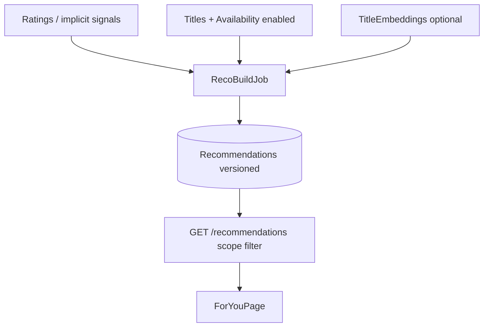

# ANALYSIS — raccomandazioni

> Generato da: agente (incremental-dev-planning)
> Data assessment: 2026-11-06
> Branch: `main` @ `58acd390c989de2f68e789c03b1bc01c9d683aab`

---

## 1. Contesto e perimetro

### 1.1 Obiettivo

Implementare voto (mi piace / non mi piace) sul `Title` e raccomandazioni locali a livelli (prior → profilo sparso → embedding kNN → classificatore opzionale), con pagina `/for-you` filtrata sui cataloghi importati, secondo `docs/raccomandazioni.md` v0.2.

**Richiesta utente (2026-11-06):** dominio nuovo `raccomandazioni`; perimetro R1→R4 intero documento; tutti i requisiti M/S/C; spike SP-R1…SP-R4 come task prima delle fasi dipendenti; SP-R5 solo nota rischio; i18n solo `en.json`; `reco.enabled` già in R1; livello 3 e eventi in R4 (eventi default off); aggiornamento `documento-funzionale.md` + `specifica-tecnica.md` prima della verifica finale; BASELINE leggera; non toccare KB `pickarr-mvp`; nessun commit senza richiesta; taglio tranche deciso dall’analisi.

| Requisito | Criterio verificabile | Task previsti | Fonte |
| --------- | -------------------- | ------------- | ----- |
| R-RT | Voto Like/Dislike su Title.Id; PUT/DELETE; campo `rating` su list/detail; UI card/scheda ottimistica; gating `reco.enabled` | T02–T03, T07 | FR-REC-RT-01..04,07; FR-REC-ST-01 |
| R-RT-EXT | Pagina `/ratings`, export/import JSON, scorciatoie L/D, onboarding `/taste` | T09, T12, T18 | FR-REC-RT-05,06,08,09 |
| R-SG | Segnali impliciti favorite/arrAdd/downloaded; voto esplicito prevale; Delete non nega Add; toggle implicits | T11–T12 | FR-REC-SG-01..04 |
| R-RC | `/for-you` scope source\|enabled; esclusione votati; filtri; motivi; simili enabled+places; rebuild | T04–T06, T08, T11–T12, T17–T18 | FR-REC-RC-* |
| R-CD | Pool = Availability su sorgenti abilitate; RemovedAt irrilevante; keyword/crediti da enrichment esistente | T04, T10 | FR-REC-CD-01..04 |
| R-ML | ONNX locale opzionale; fallback L0/L1; download/hash/self-test; limiti thread | T13, T15–T17 | FR-REC-ML-01..05 |
| R-AD | Settings recommendations; azioni admin; eval offline; reset; event log default off; L3 sempre in R4 | T19–T22 | FR-REC-AD-*; FR-REC-ML-06; utente |
| R-ST | Toggle enabled/implicit/model/explore; lingua da CatalogSource; avanzate pesi | T02, T12, T19 | FR-REC-ST-01..04 |
| R-DOCS | Allineare docs prodotto §21 | T23 | docs/raccomandazioni.md §21 |
| R-SPIKE | SP-R1 prima enrichment R2; SP-R2 prima ONNX R3; SP-R3/SP-R4 misure | T01, T13–T14, T22 | §19.1 |

### 1.2 Fonti analizzate

- `docs/raccomandazioni.md` v0.2
- `AGENTS.md`
- Entity Core: `Title`, `Availability`, `CatalogSource`, `Provider`, `Favorite`, `ArrLibraryItem`, `ArrAuditLog`, `TitleLocalization`, `Genre`, `TitleGenre`, `AppSetting`
- `CatalogUpserter.ResolveTitleAsync`, `TitleQueryService`, `TitleQueryModels`
- `EnrichmentService`, `TmdbMetadataProvider`, `TmdbJsonModels`, `TmdbModels`
- `FavoriteService`, `FavoritesEndpoints`, `FavoriteButton.tsx`
- `HangfireBootstrap`, `SyncRunKinds`, `AdminEndpoints`, `SettingsKeys`, `SettingsEndpoints`
- WebApp: `router.tsx`, `CatalogPage`, `FilterBar`, `TitleCard`, `TitleDialog`, `Header`, `sourcePreference.ts`, `en.json`
- `Program.cs` / `SystemEndpoints` (assenza `/events`)
- Test: `TitleQueryServiceTests`, `EnrichmentServiceTests`, `FavoritesApiTests`, `FavoriteButton.test.tsx`

### 1.3 Stato as-is (sintesi)

Catalogo self-hosted già operativo: titoli unificati, availability per sorgente, preferiti globali, libreria Arr, enrichment TMDB con keywords/credits nel payload ma keywords non persistite e cast solo nomi in `CastJson`. Nessuna tabella/API/UI di rating o raccomandazioni. Hangfire: code `default`/`sync`/`arr`, un server. UI catalogo/lista/settings senza `/for-you`. SSE assente. Path reale frontend: `src/Pickarr.WebApp` (il doc §15 cita `frontend/` obsoleto).

Dettaglio metriche: `BASELINE.md`.

---

## 2. Componenti principali

| Componente | Ruolo | File | Accoppiamento |
| --- | --- | --- | --- |
| `Title` + merge | Identità voto | `src/Pickarr.Core/Domain/Entities/Title.cs`; `CatalogUpserter.ResolveTitleAsync` | alto |
| `Availability` | Scope/pool | `Availability.cs`; join in `TitleQueryService` | alto |
| `TitleQueryService` | Griglia catalogo (filtra RemovedAt) | `TitleQueryService.cs` | alto — **non riusare predicato RemovedAt per reco** |
| `TitleListItemDto` | Card DTO (`RatingTmdb`, no user rating; `CatalogPlaceDto` senza removedAt) | `TitleQueryModels.cs` | alto |
| `Favorite` / `FavoriteButton` | Pattern toggle globale; **non ottimistico oggi** | `FavoriteService.cs`; `FavoriteButton.tsx` | medio |
| `EnrichmentService` + TMDB | Unico client metadati; keywords→stand-up only | `EnrichmentService.cs`; `TmdbMetadataProvider.cs` | alto |
| Hangfire / `SyncRunKinds` | Job sync; manca coda `ml` e kind Reco* | `HangfireBootstrap.cs`; `SyncRunKinds.cs` | medio |
| Settings | Chiavi dotted; nessuna `reco.*` | `SettingsKeys.cs`; `SettingsPage.tsx` | medio |
| `sourcePreference` | Sorgente condivisa catalogo | `sourcePreference.ts` (`pickarr.sourceId`) | medio |

---

## 3. Flussi individuati

### FLUSSO-01 — Query catalogo / lista

- **Trigger**: `GET /api/v1/catalog/titles` → `TitleQueryService.QueryTitlesAsync`
- **File**: `TitleQueryService.cs`, `CatalogEndpoints.cs`
- **Sequenza**: filtri view/type/genre; default `RemovedAt == null` su sorgente; map DTO + places solo non-rimossi
- **Dipendenze**: SQLite, Arr configurato (altrimenti griglia vuota)
- **Rischi**: copiare `RemovedAt == null` in reco (RR-06)
- **Test**: `TitleQueryServiceTests`

### FLUSSO-02 — Preferito globale

- **Trigger**: PUT/DELETE `/api/v1/favorites/{id}` → `FavoriteService`
- **File**: `FavoritesEndpoints.cs`, `FavoriteButton.tsx`
- **Sequenza**: upsert/delete su `Favorites`; UI invalidate onSuccess (no rollback ottimistico)
- **Dipendenze**: DB
- **Rischi**: doc assume optimistic update — da implementare ex novo per rating
- **Test**: `FavoritesApiTests`, `FavoriteButton.test.tsx`

### FLUSSO-03 — Enrichment TMDB

- **Trigger**: `EnrichmentJob` / refresh → `EnrichmentService.EnrichCoreAsync`
- **File**: `EnrichmentService.cs`, `TmdbMetadataProvider.cs`
- **Sequenza**: GET movie/tv con `append_to_response=external_ids,keywords,credits`; applica generi/voti/cast nomi; keywords solo stand-up; en-US solo se fallback lingua
- **Dipendenze**: TMDB rate limit
- **Rischi**: crediti senza person id; keywords non in DB; backfill necessario (SP-R1)
- **Test**: `EnrichmentServiceTests`

### FLUSSO-04 — Merge titolo

- **Trigger**: sync catalogo → `CatalogUpserter.ResolveTitleAsync`
- **Sequenza**: WatchmodeId → TmdbType+TmdbId → create
- **Rischi**: due Titles = due voti (BR-REC-08, accettato)
- **Test**: `CatalogUpserterTests`

### FLUSSO-05 — Raccomandazioni (to-be, assente)

- **Trigger**: voto / job → profilo+score → `GET /recommendations` con scope in lettura
- **Stato**: ❌ non implementato

### FLUSSO-06 — Embedding ONNX (to-be, assente)

- **Trigger**: modello pronto → `RecoEmbeddingJob` → kNN in build
- **Stato**: ❌ non implementato

---

## 4. Dipendenze e vincoli tecnici

| Dipendenza | Tipo | Vincolo | Impatto |
| --- | --- | --- | --- |
| SQLite WAL `/config` | infra | hard | voti nel DB principale; rebuild su coda dedicata |
| TMDB | servizio | hard; BR-REC-10 no Watchmode | solo enrichment esistente + eventuale en-US |
| Hangfire | infra | soft estendere | secondo server `ml` WorkerCount=1 |
| ONNX Runtime | lib | soft finché R3 | CPU amd64/arm64; modello fuori immagine base |
| Nessuna SSE | codice | soft | refetch/invalidate dopo voto (§14.4) |
| AGENTS.md i18n EN | prodotto | hard (V-REC-05) | solo `en.json` |

---

## 5. Problematiche e tech debt rilevati

| ID | Gravità | Descrizione | Impatto se non risolto |
| --- | --- | --- | --- |
| A-001 | Alta | `TitleQueryService` e `MapPlaces` filtrano `RemovedAt == null` | Reco errate se si riusa la query (RR-06) |
| A-002 | Alta | Keywords/credits nel payload ma non persistiti; cast senza person id | L1 incompleto senza T10 |
| A-003 | Media | `FavoriteButton` senza `onMutate` | Non è template per FR-REC-RT-07 |
| A-004 | Media | `CatalogPlaceDto` senza `removedAt` | Scope enabled/simili non allineati al doc |
| A-005 | Media | Nome `TitleRatingsDto` = voti TMDB | Collisione concettuale col campo user `rating` |
| A-006 | Bassa | Doc §15 path `frontend/` obsoleto | **RESOLVED T23** — path WebApp in specifica + raccomandazioni §15 |
| A-007 | Bassa | AGENT_KB comune CONV-04 cita `backend/`/`frontend/` | Usare AGENTS.md (V-REC-09) |
| A-008 | Info | SP-R5 licenze: rischio RR-09, non in roadmap | Monitorare a rilascio R3 |

---

## 6. Architettura target (to-be)

### 6.1 Principi guida

1. Voto e profilo globali sul `Title`; filtro catalogo solo in lettura (scope).
2. Algoritmo puro in Core; Infrastructure per EF/Hangfire/ONNX/TMDB.
3. Predicato membership reco dedicato, distinto dalla griglia catalogo.
4. Livelli degradabili: senza modello → L0+L1; senza segnali → prior.
5. Una immagine Docker; modello scaricato o copiato in `/config/models`.

### 6.2 Pattern

Pipeline: segnali → (features enrichment) → embeddings? → `RecoBuildJob` pubblica `Recommendations(version)` → API filtra scope/page → React.

Coda Hangfire `ml` isolata. Settings `reco.*`. UI feature folders `features/ratings`, `features/reco`, settings recommendations.

### 6.3 Alternative scartate

| Alternativa | Pro | Contro | Motivo esclusione |
| --- | --- | --- | --- |
| Pool TMDB / titoli Harvested | più candidati | fuori catalogo importato | D-REC-02; v0.2 |
| Ordinamento Per te nella griglia catalogo | meno route | confonde filtri catalogo | D-REC-07 |
| Voto per sorgente | granularità | viola un voto per Title | D-REC-06 / principio 1 |
| Riuso `TitleQueryService` per reco | meno codice | RemovedAt e places sbagliati | A-001 |

### 6.4 Diagramma

---

## 7. Scoperte post-assessment

| Data | Sezione impattata | Scoperta | Impatto sul piano |
| --- | --- | --- | --- |
| 2026-11-06 | §4–5, K-012 | SP-R1: URL `append_to_response=external_ids,keywords,credits` sufficiente; gap solo DTO (cast id, crew, created_by root TV, origin_country root). Fixtures senza credits. en-US oggi solo se title/overview vuoti; BR-REC-09 richiede en-US anche con overview piena (+1 call/titolo backfill). | T10 GO; checklist in artifacts/SP-R1.md; D-012 |
| 2026-11-06 | §2 | Introdotte tabelle Ratings/RatingEvents; campo API `rating` su list/detail; settings `reco.*` (enabled default true); 409 RECO_DISABLED | TR-02 DONE; rebuild debounce ancora assente (T05/T11) |
| 2026-11-06 | §2, §6, FLUSSO-05 | Core `RecoMembership`/`RecoPrior`/`RecoLearning`; tabelle Recommendations/RecoState; Hangfire server `ml`; `RecoBuildJob` L0; `GET /recommendations` + `/status`; `CatalogPlaceDto.RemovedAt` | TR-03 DONE; UI Per te ancora T07–T08; L1/segnali T11; MMR/diversify no-op fino a T18 |
| 2026-11-06 | K-014, §13, FLUSSO-06 | SP-R2 GO: `Microsoft.ML.OnnxRuntime` + `BertTokenizer`; Xenova `model_quantized.onnx` ~23 MB SHA `AFDB6F1A…BDB1`; modelId invariato `all-MiniLM-L6-v2@q8` | TR-08 sbloccata; artifacts/SP-R2.md |
| 2026-11-06 | FLUSSO-05/06 | TitleEmbeddings; RecoModel/Embedding jobs; kNN L2; MMR/explore; `/taste`; admin reco; settings recommendations | TR-07 T13 + TR-08 T15–T19 DONE; T14 SP-R3 ancora aperto |
| 2026-11-06 | K-013, NFR-REC-01/02 | SP-R3: L1 rebuild 8.4s PASS; GET plain p95 114ms PASS; GET+MMR 425ms / similar 2.6s / L2 28s FAIL | artifacts/SP-R3.md; K-013 PARTIAL; T14 DONE |
| 2026-11-06 | K-013, FLUSSO-05/06 | Mitigazioni SP-R3 in TR-08: GET materializza max(200, pageEnd); similar prova emb senza sparse pool + narrow genere/cap 800; ScoreAll maxSignals=64 | K-013 da rivalidare con SpR3; acceptance T17–T19 rafforzata |
| 2026-11-06 | K-013 | Rivalidazione SpR3: MMR ~150ms / similar ~77ms / L2 ~10s PASS-bordo; L1 ~10.1s bordo; utente sceglie RESOLVED | artifacts/SP-R3.md aggiornato; D-013; K-013 RESOLVED |
| 2026-11-06 | TR-09 T20–T22 | Eval leave-one-out + L3 ML.NET gated + RecoEventLog + SP-R4 defaults tenuti | migrazione AddRecoEvalAndEvents; artifacts/SP-R4.md; D-014 |
| 2026-11-06 | TR-10 T23 / R-DOCS / A-006 | documento-funzionale + specifica-tecnica v0.2; D-REC; path `src/Pickarr.WebApp`; F-005 RESOLVED | docs/*.md |

---

## 8. Fatti e ipotesi riusabili

| ID | Tipo | Informazione | Fonte e versione | Rivalidare quando |
| --- | --- | --- | --- | --- |
| K-001 | FACT | Merge titolo: WatchmodeId poi TmdbType+TmdbId | `CatalogUpserter.ResolveTitleAsync` @ HEAD | cambio ResolveTitleAsync |
| K-002 | FACT | Pool abilitato = stessa regola `ListSourcesAsync` (source+provider enabled) | `TitleQueryService.ListSourcesAsync` | cambio IsEnabled |
| K-003 | FACT | Catalog default esclude RemovedAt; places mappati solo non-rimossi | `TitleQueryService` | cambio MapPlaces/query |
| K-004 | FACT | TMDB già `append_to_response=external_ids,keywords,credits` | `TmdbMetadataProvider` | cambio URL TMDB |
| K-005 | FACT | TmdbCreditsDto solo name+order; no person id/crew/created_by | `TmdbJsonModels.cs` | estensione DTO (T10) |
| K-006 | FACT | Keywords usate solo da `TmdbStandUp`; non in tabelle | `EnrichmentService.ApplyDetails` | T10 |
| K-007 | FACT | Nessuna coda `ml` / SyncRunKinds Reco* | `HangfireBootstrap`, `SyncRunKinds` | T05 |
| K-008 | FACT | Nessun `/events` SSE | `Program.cs` | se si aggiunge canale |
| K-009 | FACT | FavoriteButton senza onMutate | `FavoriteButton.tsx` | se si aggiunge optimistic favorites |
| K-010 | FACT | source key `pickarr.sourceId` | `sourcePreference.ts` | rename key |
| K-011 | FACT | Worktree: ~328 path dirty; diff src≈solo EOL (22253±) | git status/diff 2026-11-06 | prima esecuzione T01 |
| K-012 | FACT | Payload TMDB già richiesto basta per cast.id, crew Director, created_by (root TV), origin_country (root); estendere solo DTO. Fixtures test incomplete (no credits). | artifacts/SP-R1.md; TmdbMetadataProvider; docs TMDB; HEAD 58acd390 | cambio append_to_response o shape API |
| K-016 | FACT | en-US extra oggi solo se NeedsEnglishFallback; per embedding serve policy più ampia (+1 call se manca loc en-US) | EnrichmentService + LanguageFallback; SP-R1 §2 | cambio LanguageFallback / RecoFeatureJob |
| K-013 | RESOLVED | Post TR-08 SpR3: GET plain/MMR/similar/enabled p95 PASS (&lt;300ms); L1/L2 rebuild sul bordo ~10s (±3% host). Decisione utente: chiudere senza altro round L1 | artifacts/SP-R3.md §4–7; D-013 | — |
| K-017 | FACT | L3 attivato solo via `RecoState.Level3Active` dopo eval che batte L2; sotto `reco.ml.minRatings` resta inattivo | RecoEvalService; RecoBuildService; D-014 | cambio gate |
| K-018 | FACT | `reco.events.enabled` default false; log Liked da RatingService; Shown/Opened via POST `/recommendations/events` | RecoEventLogService | — |
| K-014 | FACT | all-MiniLM-L6-v2@q8 (Xenova quantized) + BertTokenizer + ORT self-test OK su host win-x64; SHA ONNX fissato | artifacts/SP-R2.md; RecoOnnxEmbedderTests | cambio file modello / tokenizer |
| K-015 | DECISION | Perimetro e vincoli utente 2026-11-06 | STATUS.md §4 D-001.. | nuova decisione utente |
