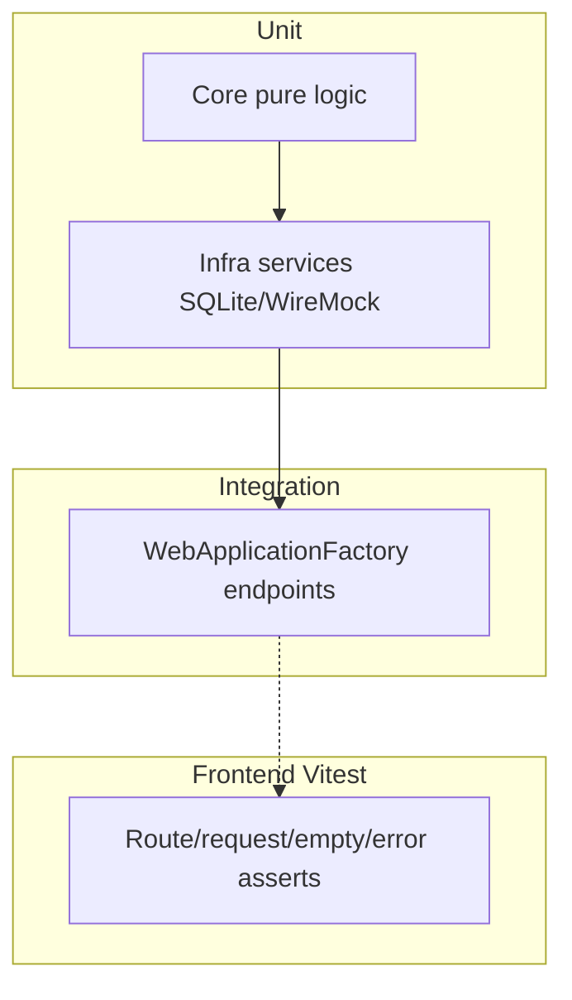

# ANALYSIS — test-coverage

> Generato da: agente incremental-dev-planning
> Data assessment: 2026-11-09
> Branch: `main` @ `c576634b3809b2c1f598ce6c1ae114b37f17f49c`

---

## 1. Contesto e perimetro

### 1.1 Obiettivo

Aumentare la copertura di test **sensati e utili** (unit + integration, frontend + backend) e rendere gli esistenti **accurati**, così da poter modificare il codice con bassa paura di regressioni. Coprire happy path, edge case e gestione eccezioni/errori HTTP.

Richiesta originale (fedelmente): analisi approfondita del codice e dei test; aumentare copertura con test sensati; assicurarsi che gli attuali siano accurati e aggiornarli; ambiente controllato per modifiche; happy path + edge + eccezioni complete.

| Requisito | Criterio verificabile | Task previsti | Fonte/approvazione |
| --- | --- | --- | --- |
| R-01 Misura baseline e tooling coverage | Report coverlet/vitest (o comando documentato) riproducibile; KPI in STATUS §6 aggiornabili | T01 | richiesta 2026-11-09 |
| R-02 Igiene e accuratezza test esistenti | Test fragili/condivisi/assert deboli identificati e corretti o accettati con finding | T02, T03, T13 | richiesta + AGENTS.md |
| R-03 Gap backend service critici | CatalogConfiguration, SeriesGuide edge, Admin trigger/quota, sync exception path con test PASS | T04–T06 | assessment |
| R-04 Gap API integration | Endpoint titoli (seasons/404/similar), catalogs settings, favorites mutate, Arr happy/error con WireMock | T07–T09 | assessment |
| R-05 Gap frontend flussi core | client API, CatalogPage empty/filters, TitleDialog/seasons, AddToArr errori | T10–T12 | assessment |
| R-06 Completare FE secondario + harden | Pagine residue e test FE deboli aggiornati | T13 | assessment |
| R-07 Verifica finale indipendente | PASS su versione identificata, rapporto in ARCHIVE | T14 | skill |

### 1.2 Fonti analizzate

- `AGENTS.md`, `docs/documento-funzionale.md` / `docs/specifica-tecnica.md` (riferimento prodotto, non riletti interamente)
- Endpoint: `src/PickArr.Api/Endpoints/*.cs` (11 file)
- Servizi Infrastructure rilevanti: `CatalogConfigurationService`, `TitleQueryService`, `FavoriteService`, `RatingService`, `AdminJobService`, `SeriesGuideService`, sync Watchmode/Leaving/Enrichment
- Test: `tests/PickArr.{Core,Infrastructure,Integration}.Tests/**`
- Frontend: `src/PickArr.WebApp/src/**` + `*.test.ts(x)`, `vite.config.ts`, `package.json`
- Package: `Directory.Packages.props` (coverlet.collector), csproj test

### 1.3 Stato as-is (sintesi)

Suite già ampia su dominio catalog sync, reco, settings env, ratings. Punti ciechi importanti: **setup cataloghi API/servizio**, **season/episode API**, **Arr add/delete end-to-end via HTTP**, **client FE e CatalogPage**, molti componenti UI senza test. Collection `"api"` condivisa crea rischio di flaky/false confidence. Coverlet presente ma **nessun report/gate CI**; Vitest **senza coverage**. Dettaglio metriche → `BASELINE.md`.

---

## 2. Componenti principali

| Componente | Ruolo | File | Accoppiamento |
| --- | --- | --- | --- |
| Minimal API endpoints | Contratti HTTP | `src/PickArr.Api/Endpoints/*` | medio (DI servizi) |
| `TitleQueryService` | Query catalogo/lista/filtri/emptyReason | `Infrastructure/Catalog/TitleQueryService.cs` | alto (EF) |
| `CatalogConfigurationService` | Enable provider/country + limiti free plan | `Infrastructure/Catalog/CatalogConfigurationService.cs` | alto |
| `FavoriteService` | Preferiti idempotenti | `Infrastructure/Catalog/FavoriteService.cs` | basso |
| Sync catalogo (full/incr/leaving/bootstrap) | Import Watchmode + budget | `Infrastructure/Catalog/*`, `Jobs/*` | alto |
| `EnrichmentService` / TMDB | Metadata | `Infrastructure/Metadata/*` | alto (HTTP) |
| Arr add/delete/sync/client | Sonarr/Radarr | `Infrastructure/Arr/*` | alto (HTTP) |
| `AdminJobService` / quota | Trigger job + stato | `Infrastructure/Admin/*` | medio |
| Reco/Rating pipeline | Build/query/eval | Core `Recommendations/*` + Infra | alto |
| WebApp pages/dialogs | UI | `WebApp/src/features/**` | medio (React Query) |
| `api/client.ts` | Fetch + `ApiError` | `WebApp/src/api/client.ts` | basso |

---

## 3. Flussi individuati

### FLUSSO-01 — Catalogo titoli (source + filtri)

- **Trigger**: `GET /api/v1/catalog/sources/{id}/titles` → `TitleQueryService.QueryTitlesAsync`
- **File**: `CatalogEndpoints.cs`, `TitleQueryService.cs`, FE `CatalogPage.tsx` / `FilterBar.tsx` / `QuickFilters.tsx`
- **Sequenza**: source → Arr filter → emptyReason (arr/importing/notImported) → filtri view/type/genre/q/sort → page
- **Dipendenze**: SQLite, settings Sonarr/Radarr
- **Rischi**: flag `favorite` ignorato (contratto prodotto); FE CatalogPage non testata
- **Test**: Infra `TitleQueryServiceTests` (buono); Integration `CatalogApiTests` (parziale); FE FilterBar/router (parziale); **manca** genres/types API dedicata, QuickFilters, CatalogPage empty UI

### FLUSSO-02 — My list (favorites)

- **Trigger**: `GET/PUT/DELETE /api/v1/favorites` + FE `/list`
- **File**: `FavoritesEndpoints.cs`, `FavoriteService`, `MyListPage.tsx`
- **Sequenza**: cross-provider; types/genres da scope lista; redirect `/catalog?view=favorites` → `/list`
- **Test**: Integration `FavoritesApiTests` (1 scenario lettura); Infra idempotenza in `TitleQueryServiceTests`; FE MyListPage + FavoriteButton + router. **Manca** PUT/DELETE HTTP, genres lista, errori FE

### FLUSSO-03 — Dettaglio titolo + stagioni/episodi + similar

- **Trigger**: `GET /titles/{id}`, `/seasons`, `/episodes`, `/similar`
- **File**: `TitlesEndpoints.cs`, `SeriesGuideService`, `RecoQueryService`
- **Sequenza**: detail; seasons newest-first; episodes oldest-first + cache; similar con NotFound/RecoDisabled
- **Test**: SeriesGuide unit 1 happy; **nessuna** integration seasons/episodes/404 detail; FE TitleDialog solo rating; **SeriesSeasons/SeasonTable** senza test

### FLUSSO-04 — Arr add/delete/refresh/options/test

- **Trigger**: POST/DELETE `/titles/{id}/arr`, refresh, `/arr/options`, `/arr/test`
- **File**: `TitlesEndpoints`, `ArrEndpoints`, `ArrAddService`, `ArrDeleteService`
- **Sequenza**: parse body → client → eccezioni `ArrOperationException` → status/code
- **Test**: Infra `ArrAddDeleteTests`, `ArrClientAndSyncTests`; Integration errori (503/422/BadRequest delete) e connection test. **Manca** happy path HTTP add/delete con WireMock; refresh; FE `AddToArrDialog` assente; Delete dialog solo warning UI

### FLUSSO-05 — Settings + catalog setup

- **Trigger**: GET/PUT `/api/v1/settings`, `/settings/catalogs`
- **File**: `SettingsEndpoints`, `SettingsService`, `CatalogConfigurationService`
- **Sequenza**: secret masking; update catalog → limiti free country/quota → `CatalogSetupException`
- **Test**: Settings secret + env override; Core `CatalogCreditEstimateTests`. **Nessun** test su `/settings/catalogs` né su `CatalogConfigurationService` (unknown provider, 0 countries, free limit)

### FLUSSO-06 — Admin jobs/runs/quota

- **Trigger**: `/api/v1/admin/*`
- **File**: `AdminEndpoints`, `AdminJobService`, `AdminQuotaService`
- **Test**: Integration jobs/runs/quota + Conflict SYNC_ALREADY_RUNNING. **Parziale**: INVALID_TRIGGER BadRequest; quota projection edge in Core sì, service Admin dedicato debole/assente

### FLUSSO-07 — Sync catalogo / leaving / enrichment / bootstrap

- **Trigger**: Hangfire jobs + bootstrap
- **Test**: Infra ampia (incremental/full/leaving/bootstrap/enrichment/WireMock). Edge quota/`WatchmodeQuotaExceededException` presenti in sync tests in parte. Gap: alcuni rami catch generici e job error path

### FLUSSO-08 — Ratings + recommendations

- **Trigger**: ratings/reco endpoints + FE For you / Taste / RatingButtons
- **Test**: Core algo + Infra build/query + Integration ratings/reco/admin reco **buoni**; FE reco/ratings **discreti**. Gap residuali: MyRatingsPage, SimilarRow, LearningProgress, client error surfacing

### FLUSSO-09 — Health/system

- **Trigger**: `/health`, `/api/v1/system/status`
- **Test**: `SettingsAndHealthTests` — adeguato per MVP

---

## 4. Dipendenze e vincoli tecnici

| Dipendenza | Tipo | Vincolo | Impatto |
| --- | --- | --- | --- |
| SQLite in-memory / temp DataPath | infra | TC-05 | Isolation test |
| WireMock.Net | lib | fixtures `tests/fixtures` | HTTP esterni |
| Hangfire Memory | infra | TC-05 | No SQLite Hangfire nei test API |
| xUnit collection `"api"` | test | TC-06 | Stato condiviso |
| coverlet.collector | lib | nessuno gate | Coverage non misurata in CI |
| Vitest + Testing Library + jsdom | lib | TC-08/11 | FE unit; no coverage config |
| React Query / Router / i18n | lib | stub localStorage preferenza source | Pattern già in router.test |

---

## 5. Problematiche e tech debt rilevati

| ID | Gravità | Descrizione | Impatto se non risolto |
| --- | --- | --- | --- |
| A-001 | Alta | `CatalogConfigurationService` e `GET/PUT /settings/catalogs` senza test | Regressioni limiti free plan / paese obbligatorio silenziose |
| A-002 | Alta | Collection `"api"` condivisa: `CatalogApiTests.Seed` usa `if (!Any titles)`, `ArrActionApiTests` cancella Sonarr settings | Flaky / false green / interferenza tra test |
| A-003 | Alta | Nessuna integration su seasons/episodes/title 404/similar mapping | Contratto UI guida serie non protetto a livello HTTP |
| A-004 | Media | Arr add/delete happy path solo a livello service, non API | Breaking change su Created/body/query delete non catturata |
| A-005 | Media | FE: `CatalogPage`, `AddToArrDialog`, `api/client.ts`, `QuickFilters`, seasons UI senza test | Refactor UI ad alto rischio |
| A-006 | Media | Coverlet/vitest coverage non prodotti/gate | Non si sa quanto “aumentare copertura” numericamente |
| A-007 | Bassa | Alcuni FE test deboli (solo render/warning): `DeleteFromArrDialog`, `QuotaPanel`, `JobsPage` senza trigger | Confidence illusoria |
| A-008 | Bassa | `FavoritesApiTests` non esercita PUT/DELETE HTTP né `/genres` | Gap contratto My list |

---

## 6. Architettura target (to-be)

### 6.1 Principi guida

- Piramide: Core/unit puri → Infra service (SQLite/WireMock) → Integration API selettiva → FE behavioral
- Ogni contratto di errore stabile (`code`, status) ha almeno un test
- Isolation: stato mutabile → factory/collection dedicata
- Coverage come **indicatore**, non obiettivo vanity: priorità ai gap P0/P1

### 6.2 Pattern

1. Assessment tooling (report baseline)  
2. Harden esistenti fragili  
3. Chiudere gap P0 backend  
4. Chiudere gap P0/P1 FE  
5. Verifica indipendente

### 6.3 Alternative scartate

| Alternativa | Pro | Contro | Motivo esclusione |
| --- | --- | --- | --- |
| Solo line-coverage gate al 90% | Metrica semplice | Incentive test inutili | Obiettivo è confidence, non % |
| Solo E2E Playwright browser | Realismo UI | Costo/setup alto, fuori scope attuale | Non richiesto; FE già Vitest |
| Riscrivere tutta la suite | Uniformità | Rischio e effort XL | Preferire incrementale + harden |

### 6.4 Diagramma coverage target

---

## 7. Scoperte post-assessment

| Data | Sezione impattata | Scoperta | Impatto sul piano |
| --- | --- | --- | --- |
| 2026-11-09 | §1.3 / KPI | FE line coverage baseline 65.07%; Core-only coverlet ~49%; Infra package ~92% sotto Infrastructure.Tests | Conferma priorità gap FE api/client/arr/seasons; non vanity gate |
| 2026-11-09 | §5 A-002 | Isolamento `catalog-api` + `arr-action-api` + seed per titolo nominato + ClearArr all’inizio del test empty | K-007 confermata; F-002 risolto |
| 2026-11-09 | tooling | Commenti XML in `.runsettings` non possono contenere `--` | Documentato in artefatto T01 |
| 2026-11-09 | §5 A-001 | `CatalogConfigurationService` coperto unit; `PUT /settings/catalogs` mappa già `CatalogSetupException` → 400 | F-004 ridotto a gap HTTP (T08) |
| 2026-11-09 | FLUSSO-03 | SeriesGuide: missing→null; movie/no-tmdb→[]; TMDB null→[] senza scrivere SeasonsJson | T07 può affidarsi al service |
| 2026-11-09 | §5 A-001/A-003/A-004/A-008 | Integration: catalogs HTTP 400 free limit; seasons via SeasonsJson cached; Arr WireMock add/delete; favorites genres usano lang en-US su scope lista | F-004/6/7/8 risolti; K-008 confermata |
| 2026-11-09 | K-004 | `/settings/catalogs` ora coperto | invalidare solo se endpoint/mapping cambiano |

---

## 8. Fatti e ipotesi riusabili

| ID | Tipo | Informazione/riferimento | Fonte e versione | Rivalidare quando |
| --- | --- | --- | --- | --- |
| K-001 | FACT | Core ≈64 Fact/Theory; Infra ≈106; Integration ≈29 Fact; FE ≈39 `it`/`test` | conteggio 2026-11-09 @ `c576634` | aggiunta/rimozione test |
| K-002 | FACT | coverlet.collector in Directory.Packages.props; nessun CollectCoverage in CI locale rilevato | props + grep | cambio CI |
| K-003 | FACT | Vitest senza `coverage` in `vite.config.ts` / package.json | file @ HEAD | abilitazione T01 |
| K-004 | FACT | Nessun match test per `/settings/catalogs` | grep tests 2026-11-09 | dopo T04/T08 |
| K-005 | FACT | Collection isolate già usate per favorites/ratings/reco/settings-env; `"api"` ancora condivisa da Catalog/Arr/Admin/Settings | Integration.Tests | dopo T02 |
| K-006 | FACT | `CatalogPage`, `AddToArrDialog`, `api/client.ts`, `QuickFilters`, `SeriesSeasons` senza test dedicato | glob FE | dopo TR-04 |
| K-007 | FACT | Isolare `CatalogApiTests`/`ArrActionApiTests` in collection dedicate + seed per titolo + ClearArr: Integration 29/29 PASS | T02 2026-11-09 @ HEAD `c576634` + worktree test-coverage | se si riintroduce seed `Any()` o collection `"api"` condivisa |
| K-009 | FACT | Backend coverlet (Core.Tests): Core 48.9% line; Infra.Tests: Infra 92.3%; FE vitest 65.07% line | `artifacts/T01-coverage-baseline.md` | rivalidare dopo tranche che aggiungono test |
| K-008 | FACT | Happy path Arr via WireMock: POST add Created + DELETE notInLibrary; fixtures `tests/fixtures/sonarr` | ArrHappyPathApiTests @ TR-03 | se SonarrClient path/payload cambiano |
| K-010 | FACT | Favorite genres su scope lista risolvono localizzazioni in `en-US` (sourceId=0) | TitleQueryService.ListGenresAsync | cambio lang fallback favorites |
